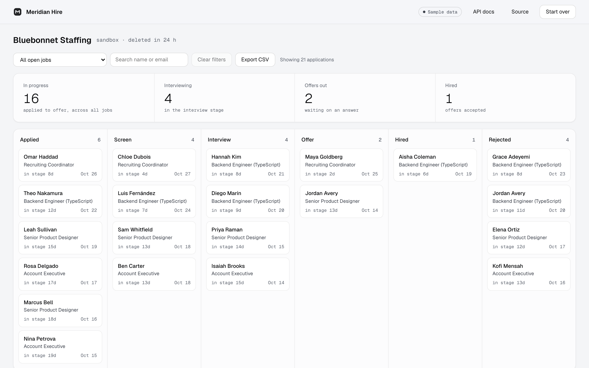

# Meridian Hire

[](https://github.com/infoallin1eventsllc-sys/meridian-hiring-api/actions/workflows/ci.yml)

A hiring pipeline API for recruiting firms: a small, multi-company applicant tracking system. Companies post jobs, candidates apply with a résumé, and each application moves from Applied to Hired, with every step recorded and sent to the firm's own systems.

It comes with interactive docs where every endpoint can be tried in the browser, and a pipeline board so people who don't write code can watch it work. Both run on a private sandbox company that anyone can create in one click.



## What it does

- **Jobs, candidates, applications.** Create, search, filter and page through each one. For example, `GET /v1/applications?job_id=…&stage=interview` lists everyone in Interview for one job. Someone who applies to two jobs stays one candidate.
- **A pipeline with rules.** Applied → Screen → Interview → Offer → Hired, or Rejected at any point. Only an offer can become a hire, and Hired and Rejected are final. A refused move says why and lists the moves that are allowed.
- **Stage history.** Every move is saved with who made it, when, and an optional note. Postgres triggers write the history, so the API can't skip it, and the API's database role can read it but not change it.
- **Résumé storage.** PDF and Word uploads go to private storage. The file type is checked from the file's contents, not its name. Downloads use links that expire after five minutes.
- **Signed webhooks.** Each new application and stage change is sent to the firm's URL, signed with HMAC-SHA256. Failed sends are retried after 1 min, 5 min, 30 min, 2 h and 12 h, and every attempt is logged.
- **Multi-company from day one.** Each company has its own API keys (scoped `read`, `write`, `admin`) and its own logins (Supabase Auth). Postgres row-level security means a company can't see another's data, even through a query bug.
- **Rate limits, audit log, clear errors.** Per-company limits come with standard `RateLimit-*` headers. An append-only audit log records who did what. Every error uses one [RFC 9457](https://www.rfc-editor.org/rfc/rfc9457) shape that names each bad field.
- **Privacy built in.** One call erases a candidate along with their applications, history and files. Webhook payloads carry ids, not personal data. The audit log records that an erasure happened, without recording who was erased.
- **Self-serve sandbox.** `POST /v1/sandbox` (no key needed) creates a demo company with sample data and an admin key, and deletes it after 24 hours.

## How I built it

I built this with [Claude Code](https://claude.com/claude-code), Anthropic's AI coding agent, as my pair programmer. Claude wrote the code, the tests and the first drafts of these docs. My part was the one a product lead does: choosing what to build, approving the plan and the stack, and deciding what went live.

**What I decided**

- The product: I asked for a project covering APIs and data storage. I chose a hiring pipeline API that works both as a portfolio piece and as something recruiting firms could buy.
- A two-phase plan: a portfolio-grade first version built on foundations that won't need rewriting, then billing, onboarding, legal and data-retention work before selling it.
- The stack: TypeScript on Vercel and Supabase, the services my studio already runs.
- To publish the code so it can be read, but keep the rights, since it's a product.
- What went live. Nothing was pushed or deployed without my go-ahead.

**How the work was checked**

- 67 automated tests run against a real Postgres database on every push. They include tests showing one company can't read or write another company's data, even when the API code is bypassed.
- Before launch, a separate security-review agent audited the code against a 20-point checklist. It found no critical issues, one high and five medium. The high one was that public sandboxes had no storage limits. All six were fixed before launch except a bot check on sandbox sign-up, which is planned.

## Engineering decisions

| Decision                                                                                                     | Why                                                                                                                                                                                                                                                                               |
| ------------------------------------------------------------------------------------------------------------ | --------------------------------------------------------------------------------------------------------------------------------------------------------------------------------------------------------------------------------------------------------------------------------- |
| Row-level security, enforced by switching role per request (`SET LOCAL ROLE hire_app` plus `app.company_id`) | Isolation lives in the database, not in every `WHERE` clause. Tests prove that a query with no filter still sees only one company.                                                                                                                                                |
| Composite foreign keys `(company_id, id)`                                                                    | An application can't point at another company's job or candidate, even if the API code were wrong.                                                                                                                                                                                |
| History and webhook events written by triggers, in the same transaction as the change                        | A stage change, its history row and its webhook event commit together or not at all (a transactional outbox).                                                                                                                                                                     |
| API keys stored as SHA-256 hashes; webhook secrets encrypted with AES-256-GCM                                | A database leak exposes no working keys. Secrets must be readable to sign with, so they're encrypted rather than hashed.                                                                                                                                                          |
| Webhook SSRF guard that checks the address at connect time                                                   | Blocks private, loopback and cloud-metadata addresses, including DNS rebinding, because the IP is checked when the connection is made. Redirects are not followed.                                                                                                                |
| Zod schemas generate both validation and the OpenAPI document                                                | The docs can't drift from the code. Unknown fields are rejected rather than silently dropped.                                                                                                                                                                                     |
| Cursor pagination on `(created_at, id)`                                                                      | Pages don't skip or repeat rows when new records arrive.                                                                                                                                                                                                                          |
| Rate limits counted in Postgres                                                                              | No extra service to run or pay for at this size. A shared cache like Redis is the upgrade path if traffic grows.                                                                                                                                                                  |
| Sandboxes instead of one shared demo company                                                                 | Each visitor gets an isolated company, which also demonstrates the multi-company design. Sandbox creation is limited per network and overall. Each sandbox has caps on records, files and daily changes, can only send webhooks to test receivers, and is deleted after 24 hours. |
| Hono on Vercel, Supabase for Postgres, Auth and Storage                                                      | Small, fast, TypeScript end to end, and hosted on services the studio already runs.                                                                                                                                                                                               |

## Run it

Requires Node 22+.

```bash
npm install
```

```bash
npm run dev:local
```

That starts a private Postgres on your machine, applies the migrations and serves everything at http://localhost:8787: the board at `/`, the docs at `/docs`, and the raw spec at `/openapi.json`. No accounts are needed. Résumés are kept in memory in this mode.

To run against your own Postgres or Supabase project, copy `.env.example` to `.env`, fill it in, then:

```bash
npm run db:migrate
```

```bash
npm run dev
```

For Supabase, also run [`db/supabase/setup.sql`](db/supabase/setup.sql) once. It creates the private résumé bucket and the every-minute job that sends webhooks and cleans up expired sandboxes.

## Tests

```bash
npm test
```

There are 67 tests across isolation, auth, validation, the pipeline rules, résumés, webhooks, rate limits, the audit log, sandboxes, abuse limits and the API reference. They run against a real Postgres: a throwaway one locally, and a `postgres:17` service in CI. GitHub Actions runs formatting, type checks and the full suite on every push.

## Project layout

```
db/migrations/      Schema, row-level security, triggers, grants
db/supabase/        Storage bucket and cron setup (Supabase only)
src/app.ts          Middleware, errors, docs, health and cron endpoints
src/auth.ts         API keys, login tokens, scopes, rate limiting
src/webhooks.ts     Signed delivery, retries, SSRF guard
src/routes/         One file per resource
src/seed.ts         Sample data for sandboxes
public/             The pipeline board (plain HTML, CSS and JS, no build step)
test/               Vitest suites
docs/PLAN.md        Roadmap: what's built and what's needed to sell it
```

## What's next

Phase 2 turns this into something firms can buy: Stripe plans, self-serve sign-up and team invites, terms and a privacy policy, per-company data-retention rules, and candidate data export. See [docs/PLAN.md](docs/PLAN.md).

## License

Copyright © 2026 Meridian Interface. All rights reserved. The code is public so it can be read and evaluated; it is not licensed for reuse or resale. See [LICENSE](LICENSE).
